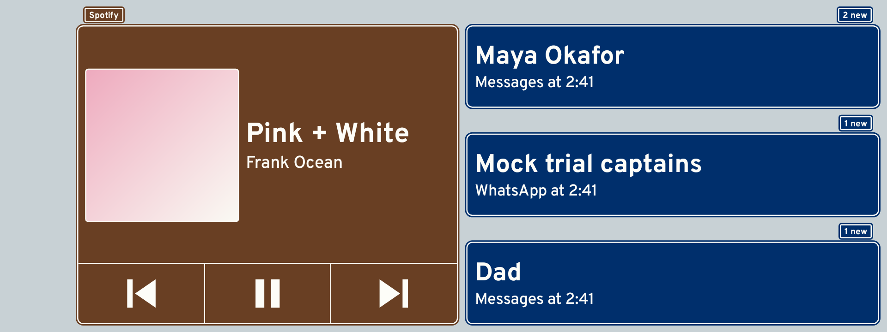
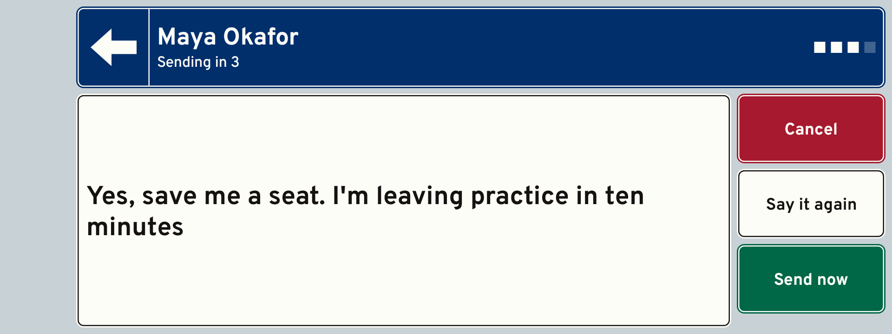

# Android Auto ++

A driving screen for a Pixel in a Hyundai Ioniq 6. It shows who has written and what is
playing as a gantry of highway signs, reads messages aloud, and sends a reply in two taps or
one spoken sentence.

It runs inside Android Auto, over the same USB cable. It does not replace Android Auto's link
to the car: the head unit only talks to a phone that proves it is running Google's app, and
the only way around that is a private key copied out of that app, which this project does not
use. What it replaces is the part you look at and touch.



## What it does

- **Messages.** Each conversation with unread messages is a blue sign. Tap it and the car
  reads the messages aloud; nothing is put on the screen to read. A conversation you have
  heard in full is marked read on the phone and leaves the board. A long one is read from its
  last five messages and stays unread, since you have not heard the rest.
- **Replies.** `Reply` quiets the music, listens through the car's microphone, shows your
  words, and sends them after four seconds unless you stop it. Four ready-made replies send at
  once. Switching to another app on the car screen drops a reply that has not sent.
- **Music.** The brown sign shows the track from Spotify (or whatever is playing) with
  previous, play or pause, and next. Sound still goes through Android Auto as it does now.
- **Day and night.** The board follows the car's own day and night switch.



## Put it on the phone

1. Turn on USB debugging on the phone and plug it into this computer.
2. Build and install:

   ```
   gradlew.bat :app:installDebug
   ```

3. Open **Auto++** on the phone and switch on the three things it lists: notification access,
   the microphone, and Android Auto's developer setting. For the last one, open Android Auto's
   settings, tap **Version** ten times, open the three-dot menu, choose **Developer settings**
   and turn on **Unknown sources**. Android Auto hides apps that did not come from the Play
   Store until that is on.
4. Plug into the car. Auto++ is in Android Auto's app list.

## Try it without the car

The phone app shows the same board, live, so most of it can be tried in the hand. Debug
builds also carry a stand-in messaging app and music player:

```
adb shell am broadcast -n com.jaspermeller.autoplus/.demo.DemoReceiver -a com.jaspermeller.autoplus.demo.MESSAGE --es from "Maya Okafor" --es text "are you coming"
adb shell am broadcast -n com.jaspermeller.autoplus/.demo.DemoReceiver -a com.jaspermeller.autoplus.demo.PLAY --es title "Pink + White" --es artist "Frank Ocean"
adb logcat -s AutoPlusDemo
```

The log shows each reply and button press as the stand-in app receives it.

To see it the way the car draws it, run Google's Desktop Head Unit (in the Android SDK under
`extras/google/auto`) with the phone plugged in: in Android Auto's developer menu choose
**Start head unit server**, then run `adb forward tcp:5277 tcp:5277` and `desktop-head-unit`.

## Build and test

Needs JDK 21 and the Android SDK. `gradlew` fetches everything else.

```
gradlew.bat :app:testDebugUnitTest :app:lintDebug :app:assembleDebug
```

The tests paint every scene of the board, at the Ioniq's size and four others, into
`app/build/renders`. That folder is the quickest way to see a design change.

## How it is put together

| Folder | What lives there |
| --- | --- |
| `signal/` | Reads the phone: messaging notifications become conversations, the active media session becomes the playing track, and replies go back through each notification's own reply action. |
| `voice/` | Text to speech for reading, speech recognition for replies. |
| `board/` | The board itself. `BoardModel` is the behaviour with no drawing in it; `BoardPainter` and `SignKit` draw it. |
| `car/` | The Android Auto side: a car app whose surface the board is painted on. |
| `phone/` | The phone screen: the same board, and the setup list. |
| `src/debug` | The stand-in messaging app and player. |

## What has been tested, and what has not

Tested on this computer: the unit tests (the board's behaviour, notification parsing, the
reply path, the speaker, the car screen through the Car App Library's test host, the stand-in
messaging app end to end), on Windows and in a Linux container. An early build also ran on an
Android 14 emulator, where a reply from the board reached the stand-in messaging app and the
media buttons reached the stand-in player; everything added after the code review has run in
unit tests only.

Not yet tested: anything that needs the real Android Auto app, which means the Desktop Head
Unit, the Ioniq itself, reading aloud through the car's speakers, and speaking a reply through
the car's microphone. The emulator image has no speech engine, so those two were exercised
only with stand-ins.

The first thing to check on a head unit is that a tap on a sign registers. Android Auto
decides whether to pass touches on the drawing surface to an app, and the whole board depends
on it. If taps do not arrive, only the button Android Auto draws itself (read the newest
message) will work.

## Type and colour

The lettering is [Overpass](https://github.com/RedHatOfficial/Overpass), an open cut of the
Highway Gothic used on US road signs, under the SIL Open Font License
(`licenses/Overpass-OFL.txt`). The colours are the Federal Highway Administration's Pantone
matches for sign colours, and each keeps its road meaning; `Palette.kt` lists them.

Created in [T3 Code](https://t3.codes).
